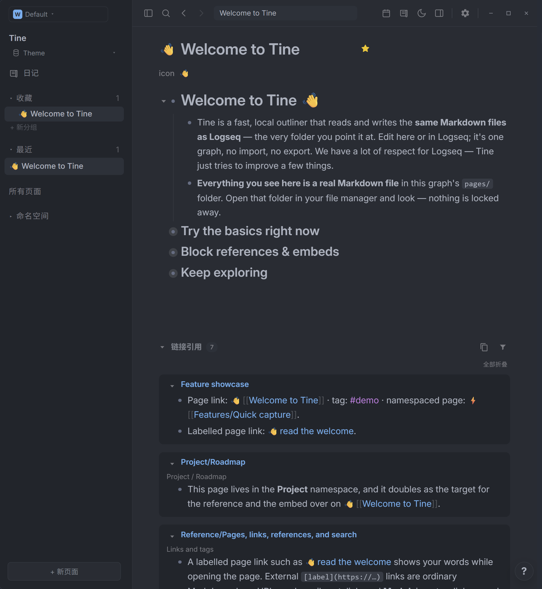
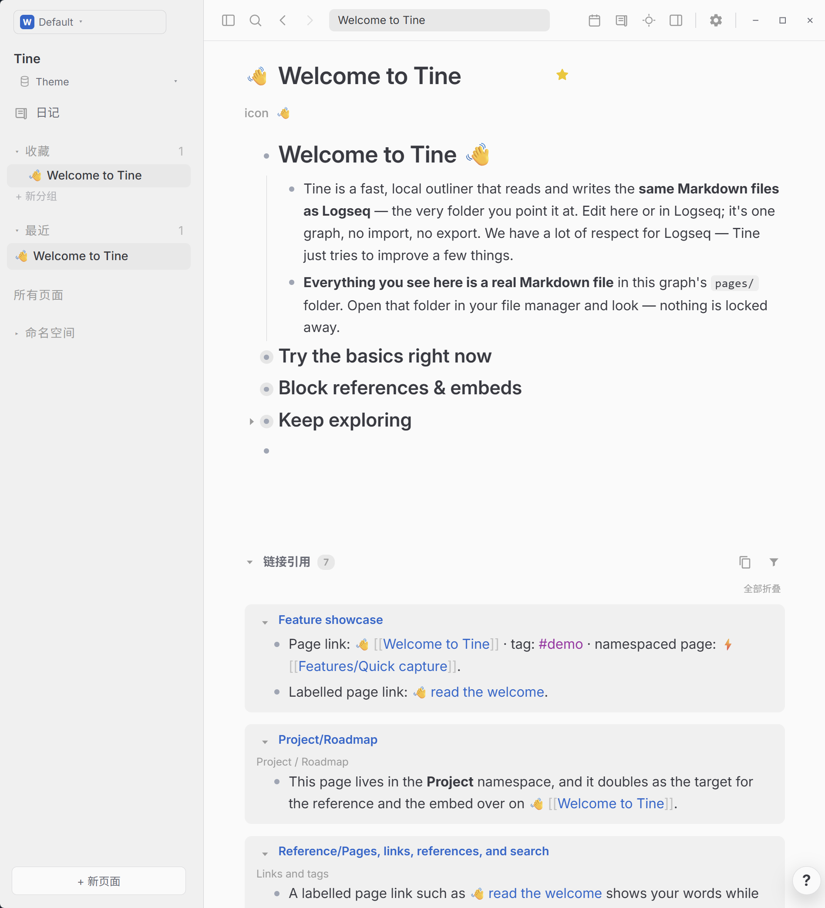

# One · Prism

**浅页接住清晨，炭灰留住夜色；几笔明亮，给思绪留出位置。**

[English](README.md) · [下载 theme.json](https://github.com/EllisMorrow/tine-theme-one-prism/releases/latest/download/theme.json)

One Light 与 One Dark 合为一款 Tine 主题，以安静的中性底色，映衬熟悉的蓝与紫。

在 [Prism 主题画廊](https://github.com/martinkoutecky/tine/discussions/786)中，可以直观比较全部 29 个主题的浅色与深色效果。

### 深色模式

### 浅色模式

*用户测试后提供的 Windows 实机截图，两套配色均实际包含在同一个主题包中。*

## 安装

1. 下载 [theme.json](https://github.com/EllisMorrow/tine-theme-one-prism/releases/latest/download/theme.json)。
2. 在 Tine 打开 **设置 → 外观 → 主题包 → 选择 theme.json**，选择下载的文件。
3. 点击 **使用颜色**，选择 **浅色、深色或跟随系统**。

需要主题 API **0.2** 支持。原有 `logseq/custom.css` 和设备强调色可能影响效果；主题只负责 API 支持的颜色，不包含额外字体、布局或任务标记样式。

## 配色

| 角色 | 浅色 | 深色 |
| --- | --- | --- |
| 主背景 | `#fafafa` | `#282c34` |
| 侧栏 | `#f0f0f0` | `#21252b` |
| 正文 | `#383a42` | `#abb2bf` |
| 标题 | `#383a42` | `#abb2bf` |
| 强调色 | `#4078f2` | `#61afef` |
| 链接 | `#0066cc` | `#61afef` |
| 标签 | `#a626a4` | `#c678dd` |
| 高亮底色 | `#f4e7c5` | `#514b3b` |

## 验证情况

通过官方主题格式检查；浏览器样例检查了两套完整变量、模式切换及指定颜色组合。用户提供了上方 Windows 明暗实机截图，展示公开欢迎页面上的标题、正文、层级、链接、标签、行内代码和引用区域。高亮、选中操作、设置状态和其它平台未由这些截图覆盖，不据此宣称全部路径均已验证。

## 来源与边界

基于 [Atom One Light / One Dark](https://github.com/atom/one-dark-syntax)，固定版本 `9c96f4454362267ac45322063e193ccf9d2debb1`，采用 MIT 许可并保留 [原始声明](LICENSE)。基于 Atom 官方 One Light 与 One Dark 语法主题仓库，固定版本分别为 d84579027410c576086dfca14d934c4bd74b0438 与 9c96f4454362267ac45322063e193ccf9d2debb1；颜色角色独立映射至 Tine 主题 API。

独立社区适配由 EllisMorrow 完成，使用 AI 辅助开发。不分发 Codex 程序代码、标志或附带资源，不代表相关项目或 OpenAI 的官方产品，也不承诺与 Codex 像素级一致。具体映射和验证边界见 [适配说明](docs/adaptation.md)。

顶部徽标统计 GitHub Release 附件累计下载量，不代表安装人数。可在本仓库反馈问题，附版本、系统、模式及不包含私人内容的截图。
